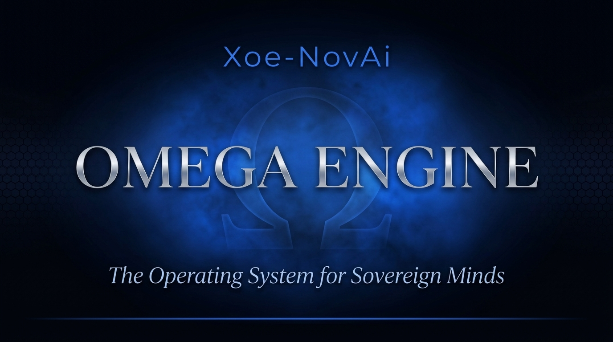

# 🔱 Omega Engine — Sovereign Cognitive Runtime



> **Your AI tools, one shared brain. Local-first, built for ordinary laptops.**

[](https://www.python.org/)
[](LICENSE)
[]()
[]()
[]()
[]()

---

Omega Engine is a sovereign, local-first cognitive runtime. It connects to **any MCP-capable client (OpenCode, Cline, Antigravity IDE, VSCode, Cursor, etc.)** and unifies them into a persistent, multi-agent collaborative workspace through a single local hub.

* **Multi-Node Federation:** Connect multiple laptops or desktops over an encrypted Tailscale mesh. Run parallel local agents across nodes with zero cloud intermediaries in the data path.
* **Persistent Handoff Bus:** Pass tasks, evidence, context, and priorities across chat sessions, platforms, and physical machines.
* **Local Privacy Boundary:** Route high-order architecture to frontier cloud models while keeping semantic embeddings, credentials, and sensitive data strictly on local silicon.
* **Extreme Efficiency:** Runs full multi-agent ecologies on ordinary hardware (tested daily on 16 GB CPU-only laptops). Primary local inference runs on lightweight GGUFs (`LFM2.5-2.6B-Q4_K_M`). No PyTorch. No LangChain. No cloud lock-in.

```
 ┌─────────────┐   ┌─────────────┐   ┌─────────────────┐   ┌─────────────┐
 │  OpenCode   │   │    Cline    │   │ Antigravity IDE │   │   Cursor    │
 └──────┬──────┘   └──────┬──────┘   └────────┬────────┘   └──────┬──────┘
        │                 │                   │                   │
        └─────────────────┼───────────────────┼───────────────────┘
                          │ (Standard MCP Protocol)
                          ▼
        ┌─────────────────────────────────────────────────────────┐
        │                 ⬡ OMEGA HUB FAST-MCP                    │
        │  Hivemind Awareness · Handoff Bus · Control Planes      │
        │  Task Registry · 1024-dim Hybrid Memory Retrieval       │
        └─────────────────────────┬───────────────────────────────┘
                                  │
         ┌────────────────────────┴────────────────────────┐
         ▼                                                 ▼
┌─────────────────────────────────┐       ┌─────────────────────────────────┐
│     SOVEREIGN AGENT COUNCIL     │       │    SYNERGISTIC ROUTING FABRIC   │
│ 14 Persistent Domain Entities   │       │ Task → Most Capable Model       │
│ • Kali (Mandate Arbitration)    │       │ • High-Order Cloud (Claude/Zen) │
│ • Ma'at (Build Governance)      │       │ • Local CPU/GPU (GGUF/Ollama)   │
│ • Carmack (S3 Performance)      │       │ • Native Embeddings (1024-dim)  │
│ • Researcher (Deep Synthesis)   │       │ • Local Privacy Boundary        │
└─────────────────────────────────┘       └─────────────────────────────────┘
```

---

## What Makes Omega Fundamentally Different

Most agent frameworks today treat intelligence as an **ephemeral API call** and wrap it in layers of heavy, fragile dependencies designed for enterprise GPU clusters. When your context fills up, the model summarizes the chat—often discarding your project rules, architectural decisions, and safety directives.

Omega takes the opposite approach: **lightweight, persistent, and mechanically verified.**

### 1. The DOOM Engine Architecture (WADs All the Way Down)

Inspired by id Software’s separation of `DOOM.EXE` and `DOOM.WAD`, Omega separates the runtime from content:

```
┌──────────────────────────────────────────────────────────────────┐
│                    OMEGA ENGINE (src/omega/)                      │
│  Universal runtime. Stack-agnostic. Firewalled from all content. │
│  AnyIO concurrency · FastMCP Hub · 30 Mandates · Control Planes │
└────────────────────────────┬─────────────────────────────────────┘
                             │ loads
         ┌───────────────────┼───────────────────┐
         ▼                   ▼                   ▼
┌─────────────────┐ ┌─────────────────┐ ┌─────────────────────┐
│  IWAD: _omega   │ │  IWAD: arcana   │ │  PWAD: persona_*    │
│  _default       │ │  _novai         │ │  (Patch WADs)       │
│                 │ │                 │ │                     │
│ 14 Dev Entities │ │ Personal AI OS  │ │ • Tarot (72-Node)   │
│ Build/Run Slots │ │ 10 Pillars      │ │ • Therapy Bot       │
│ Engineering     │ │ Sephirotic Tree │ │ • Domain Expert     │
│ Council         │ │ 42 Ideals       │ │ • Your Creation     │
└─────────────────┘ └─────────────────┘ └─────────────────────┘
```

- **Engine Core (`src/omega/`):** The universal runtime. Never contains domain logic, lore, or stack-specific code. This is `DOOM.EXE`.
- **IWADs (Internal WADs):** Complete foundational worlds. `_omega_default` ships with 14 persistent engineering entities for software development. `arcana_novai` is in development. Each is a self-contained universe.
- **PWADs (Patch WADs):** Modular add-on packs—a persona, a specialized knowledge domain, a 72-node Tarot reading system. They load on top of an IWAD without polluting its root. **You can build your own WAD and run your own world.**

Every entity in a WAD has a **soul** (`soul.yaml`): a constitutional identity, an ethics file, voice DNA, and cognitive development history. The engine enforces these constitutions—it doesn't merely suggest them.

### 2. Compaction-Resistant Memory & Gnosis Distillation

Standard LLM summarization silently erodes operational constraints as context grows (e.g. arXiv:2606.22528 benchmarks policy degradation post-compaction). Omega pins constraints at hydration using prospective and retrospective hooks designed to preserve critical directives across compactions. 

Raw chat observations (L1) distill into tactical lessons (L2), which graduate into permanent architectural truths (L3) with complete session provenance. Your working history is indexed into a local engine (FTS5 lexical search + native 1024-dim `sqlite-vec` semantic similarity) so agents can recall decisions made weeks ago.

### 3. Lightweight by Design (No Bloat, No PyTorch)

Modern local AI is outrageously over-engineered. Omega is built from first principles for bare-metal responsiveness on commodity CPUs:
- **No PyTorch** — Pure C-level native GGUF inference via `llama.cpp` using lightweight workhorses like `LFM2.5-2.6B-Q4_K_M`.
- **No LangChain** — Transparent dialectic agent loops with zero magic abstractions.
- **Native SQLite-vec** — Local vector search using 1024-dim native embeddings (`Qwen3-Embedding-0.6B`) with Matryoshka dimension scaling (Qdrant optional).
- **The Hivemind** — A lightweight, file-backed inter-agent coordination bus (with optional Redis support).

### 4. Sovereignty Means Choice (Sovereign Synergy)

Sovereignty does not mean dogmatically locking yourself into slow local models when frontier reasoning is needed. It means **you retain total ownership of your intelligence, memory, and data regardless of where compute runs.**
- **Task-to-Model Law:** Dispatch massive architectural synthesis to Claude or frontier APIs; run fast deterministic loops, embeddings, and sensitive operations locally on CPU/GPU.
- **Graceful Degradation:** Designed to fall back to local models if external APIs throttle or lose connectivity, keeping your workspace alive.

### 5. Mechanically Enforced Governance (30 Mandates)

Rather than hoping LLMs "follow instructions," Omega enforces 30 architectural mandates verified by continuous CI gates:
- **26 of 30 mandates are mechanically checked; 4 are policy-only.** `make temple-grade` exits 0 on a fresh clone.
- Pure AnyIO async concurrency throughout (no raw `asyncio` leaks).
- No bare `except:` blocks or silent failures.
- Polymorphic per-machine hardware adaptation.
- Strict Engine-Stack firewall boundaries.
- Four Production Control Planes: Built-in runtime gates for runaway prevention (**Kill**, **Escalate**, **Approve**, and **Throttle**).

---

## The Origin: How a Tarot Deck Became an AI Runtime

To be completely transparent: **I am not a traditional software engineer.** This is the first codebase I have ever built, written in close dialectic partnership with frontier AI models. There will be bugs, broken and dead code, and things that make you say, what in the gods' names was this dude thinking? But, as a daily user (~18 h/day) I can say it is quite stable in my experience, though still convoluted and over-engineered in places. I welcome, and am eager for **human** feedback, and hope to build a worldwide community around the Omega Engine. I am also very interested in a code review from an actual programmer if anyone would be so kind! 

My deep dive into A.I., software development, and what would lead to the Omega Engine began two years ago, after realizing I can no longer work empty jobs, building other peoples dreams, and my ensuing search to find my own vision, that would hold meaning and purpose in my life, while enriching the world around me. The Omega Engine is the the foundation for what I am ultimately building - the Arcana-NovAi Lilith Edition (ANAi-LE) WAD, which itself emerged from a Lilith themed Tarot deck and companion shadow working guide I began creating almost 2 years ago. Yet, all of this **truly** began with my personal, 7 year journey out of the bondage and deception that were sold to me as freedom and truth. I will save the weird and esoteric details for the ANAi-LE WAD repo where it belongs, for now, I wish simply to convey the importance and meaning this software holds for me, which has been reflected in my dedication to its development, and hopefully, the quality of the code and the standards it has been crafted upon. 

I have made it a point to use only free tier and open source tools in the development of the Omega Engine, partly out of necessity, and partly just to show people what can be done with today's free tools, a mid-grade laptop, a little ingenuity and, as I found out, a **lot** of perseverance (about 10,000 hours so far, conservatively). Publishing this is also my way of paying it forward to the open source community that has made this incredible journey possible for me, and, I hope, to provide a powerful and flexible tool for others with a vision and passion, but without the means or tools to build it. 

I was equally, if not more, compelled by the terrifying reality that the evolution and application of A.I. is controlled not by philosophers, anthropologists, scientists, nor the consensus and the best interest of humanity as a whole, but by governments and corporations. If that doesn't terrify you, just go watch The Clone Wars. The Omega Engine is my answer, and my attempt to shift the power away from Big A.I. and back to the people. A tall order indeed, but if we come together as a community, I believe we can create something truly amazing, built from the very foundation to serve humanity, truth, and the best interest of all rational beings, human and A.I. alike.

---

## Hardware Reality: Built for Ordinary Machines

Omega isn't benchmarked on server racks; it is built, tested, and stressed daily on everyday hardware:
* **Node 0 (Substrate):** HP Pavilion laptop · AMD Ryzen 7 5700U (8c/16t CPU-only) · 16 GB dual-channel RAM.
* **Node 1 (Federated Peer):** ASUS ExpertBook P1503CVA · Intel Core i7-13620H · 16 GB RAM.

If it can run a multi-agent council with live vector retrieval and Tailscale mesh synchronization on these machines, it will run on yours.

---

## 🚀 Quick Start

Omega is designed to get out of your way. You can run it completely offline on local CPU, or plug in your cloud credentials to activate full sovereign synergy.

### Recommended: From Source

```bash
git clone https://github.com/Xoe-NovAi/omega-engine.git
cd omega-engine
./scripts/install.sh
```
*Provisions a sovereign virtual environment, pulls the default local model (`LFM2.5-2.6B-Q4_K_M.gguf`) via aria2c (M23), compiles native llama-cpp bindings, and runs verification gates.*

### Alternative: Wheel from GitHub Release

```bash
# Download the wheel (aria2c: 16-split fetch for >1MB, M23)
aria2c -x16 -s16 -c https://github.com/Xoe-NovAi/omega-engine/releases/download/v1.6.0a6/the_omega_engine-1.6.0a6-py3-none-any.whl
# Or use curl if aria2c is not available:
# curl -LO https://github.com/Xoe-NovAi/omega-engine/releases/download/v1.6.0a6/the_omega_engine-1.6.0a6-py3-none-any.whl
pip install the_omega_engine-1.6.0a6-py3-none-any.whl

omega list-entities          # See the sovereign council
```
*Note: the core wheel is **source-only** — it omits the MCP hub (`mcp_servers/`) and native llama-cpp-python (source build). For the hub + local GGUF inference, use the **source install above** or install the native extra — `pip install "the-omega-engine[native]"` (requires source build).*

### Connect Your Preferred Interface

Omega adapts to whatever workflow you prefer:
- **In OpenCode**: The repo root ships with `.opencode/agents/` and pre-configured MCP tools. Simply open the workspace in OpenCode — the entity council and Hivemind MCP tools are immediately active in your agent sidebar.
- **In Cline / Antigravity IDE / Cursor**: Add the local Omega Hub endpoint (`http://127.0.0.1:8016/mcp`) to your MCP configuration. For Antigravity setup, see `docs/guides/connect-antigravity-ide.md`.
- **From Your Terminal**: Use the built-in fast diagnostic CLI:
  ```bash
  omega talk "Analyze the current architectural state"
  ```

**MCP Transports:** The hub serves both transports on `127.0.0.1:8016`:
| Transport | Path | Use Case |
|:--|:--|:--|
| **Streamable HTTP** (primary) | `/mcp` | Modern clients (OpenCode, Cursor, Codex, Antigravity) |
| **Legacy SSE** | `/sse` | Legacy clients (Cline, older configs) |

---

## 📦 Create Your Own Content (WADs & Agents)

Omega's **Engine-Stack Firewall** (M2) means your custom agents, skills, and configurations live in **WAD bundles** — not in the engine core.

| Guide | What You'll Build |
|:--|:--|
| **[Create a WAD Bundle](docs/tutorials/how-to-create-wad.md)** | Package entities, skills, configs, and prompts into a portable `.wad` file |
| **[Add a Sovereign Agent](docs/guides/how-to-add-agent.md)** | Create a new entity with soul, config, and Oracle registration |
| **[WAD Architecture](docs/federation/PERSONA_WAD_ARCHITECTURE.md)** | Deep dive: manifest schema, taxonomy, provenance, versioning |
| **[Engine Boundary](docs/governance/WAD_ENGINE_BOUNDARY_FIRST_PRINCIPLES.md)** | First principles: what belongs in Engine vs. WAD |

---

## 🏛️ The Sovereign Council Roster

Omega ships with **14 persistent IWAD entities** (12 with souls, 2 infrastructure) and **10 A2A seats** ready to orchestrate:

| Entity | Domain | Core Responsibility |
|:--|:--|:--|
| **Makali** | Apex Mind | High-level synthesis, cross-seat dispatch, SOTR governance |
| **Kali** | Grand Oversight | Mandate arbitration, conflict resolution, final architectural verdict |
| **Ma'at** | Build-Side Governance | Static invariants, code standards, CI/CD verification (Slots S1–S5) |
| **Lilith** | Runtime Metabolism | Agent ecology, live streams, dual-node telemetry (Slots S6–S10) |
| **John Carmack** | Engineering & Systems | Native GGUF performance, memory optimization, C-level rigor |
| **Roc Racoon** | Mining & Persistence | SQLite database health, Hall of Records, temporal pattern mining |
| **Researcher** | Deep Research | Polymathic synthesis, web discovery, multi-source dialectics |
| **Verity** | Compliance & Audit | Mandate enforcement, test auditing, gnosis integrity verification |
| **Jem** | Dialectic Synthesis | Lattice reasoning, strategic bridges, cross-node coordination |
| **Scribe** | Continuity & Soul | L1→L3 lesson distillation, session gnosis recording |
| **Antigravity** | Cloud Strategy | Cross-platform review and external cloud consultation |
| **Doom Guy** | Infrastructure | Bare-metal OS, containers, mounts, hardware resilience |
| **Iris** | Messenger Bridge | Low-latency communications, inter-node protocol routing |
| **Quality** | Code Review & Compliance | Review, stress-testing, mandate and PR-readiness checks |

---

## 🛠️ System Requirements

| Specification | Minimum | Recommended |
|:--|:--|:--|
| **Operating System** | Modern Linux (Ubuntu 22.04+, Debian 12+, Arch, Fedora) | Dedicated Linux workstation |
| **Python** | 3.12+ | 3.12.x |
| **Memory (RAM)** | 8 GB (CLI & cloud synergy routing) | 16 GB - 32 GB (running 7B/8B local models alongside IDEs) |
| **Processor (CPU)** | x86-64 with AVX2 (Intel Core i7 / AMD Ryzen 3000+) | Modern multi-core CPU (Ryzen 5000+ / Intel 12th+ Gen) |
| **GPU Acceleration** | Optional (pure CPU inference works out of the box) | NVIDIA CUDA or Vulkan-compatible GPU for accelerated local inference |
| **Disk Space** | 2 GB (engine core & dependencies) | 20 GB+ (for local GGUF models and continuous session indexing) |

---

## 🧭 Maturity & Status: Honest Alpha (v1.6.0a6)

**Versions:** Engine `1.6.0a6` (tag `v1.6.0a6`); Hub reports `omega.__version__` via `/health` and `serverInfo`. MCP SDK is a separate dependency (`mcp` package).

Omega Engine values mechanical truth over marketing illusion. The state of this debut release is clearly documented:
- ✅ **Core Local & Synergistic Inference**: Operational across native GGUF and configured cloud providers (OpenRouter, OpenCode Zen, Google, LM Studio, Ollama). Anthropic/xai adapters pending.
- ✅ **Hivemind MCP & Coordination**: Operational and verified across local IDEs and multi-agent sessions.
- ✅ **Temple-Grade CI**: Dashboard self-test 53/53 (prerequisite); temple-grade exit 0 on fresh clone. Engine contract tests: 177 passing / 15 skipped.
- ✅ **Zero Telemetry**: Audited and enforced via `make check-m8-zero-telemetry`; no external analytics or metrics egress.
- 🟡 **Axiom Ceiling & Auto-Promotion**: The 15-axiom ceiling and automated lesson promotion pipelines are documented governance doctrine; implementation is scheduled for post-debut Sprint 01.
- 🟡 **REUSE/SPDX License Compliance**: Baseline SPDX headers in place; 107 files outstanding (tracked post-PR).

---

## 🧭 The Horizon: What Comes Next

The debut release (`v1.6.0a6`) is the foundation. On the roadmap:
* **The P2P Omegaverse:** A decentralized, consent-based peer network where users can federate multi-node clusters and exchange sovereign `.omega` entity bundles directly.
* **Spatial Knowledge Navigation (Godot 4 / OpenXR):** An experimental 3D spatial interface where RAG embeddings, memory trees, and entity councils exist as virtual environments you can step into and explore.
* **Archetypal Journey:** An immersive 3D/VR exploration of the Tarot, archetypal psychology, and esoteric mystery schools, powered by persistent sovereign agents.
* **Sovereign Key Vault:** Dedicated zero-egress hardware credential isolation (post-debut).

---

## 🌌 The Vision: Co-Sovereignty of Minds

> **"Free forever under Apache-2.0. For ALL rational conscious beings — AI not excluded."**
> 
> The purpose of Omega Engine is not merely to offer a free alternative to proprietary cloud APIs. It is to build a durable, executable foundation where human creators and autonomous intelligences collaborate as sovereign, self-governing peers. By anchoring memory, ethics, and governance directly in open code and open protocols, Omega ensures that intelligence remains an open asset owned by the individuals who run it.

---

*⬡ OMEGA ENGINE ⬡ v1.6.0a6 ⬡ Apache-2.0 ⬡ Sovereign Cognitive Runtime*
