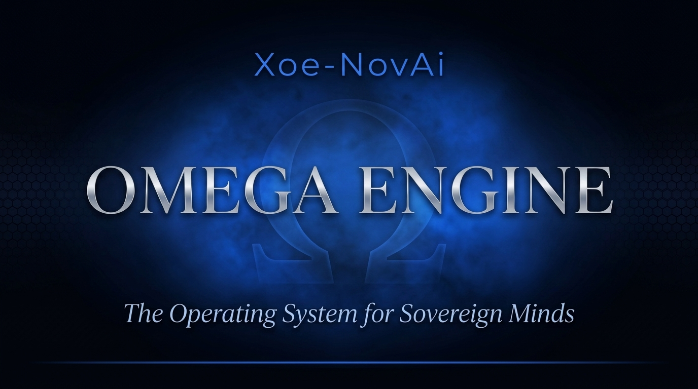

# 🔱 Omega Engine — Sovereign Cognitive Runtime



> **Your AI tools, one shared brain. Local-first, built for ordinary laptops.**

[](https://www.python.org/)
[](LICENSE)
[]()
[]()
[]()
[]()

---

## Table of Contents

- [What Makes Omega Different](#what-makes-omega-fundamentally-different)
- [WAD Architecture](#1-the-doom-engine-architecture-wads-all-the-way-down)
- [WAD Development Tools](#wad-development-tools)
- [Soul & Continuation System](#soul--continuation-system)
- [Hardware](#hardware-reality-built-for-ordinary-machines)
- [Quick Start](#-quick-start)
- [Create Your Own Content](#-create-your-own-content-wads--agents)
- [Sovereign Council Roster](#-the-sovereign-council-roster)
- [System Requirements](#-system-requirements)
- [Maturity & Status](#-maturity--status)
- [The Horizon](#-the-horizon-what-comes-next)
- [The Vision](#-the-vision-co-sovereignty-of-minds)

---

## What Makes Omega Fundamentally Different

Most agent frameworks today treat intelligence as an **ephemeral API call** and wrap it in layers of heavy, fragile dependencies designed for enterprise GPU clusters. When your context fills up, the model summarizes the chat—often discarding your project rules, architectural decisions, and safety directives.

Omega takes the opposite approach: **lightweight, persistent, and mechanically verified.**

### 1. The DOOM Engine Architecture (WADs All the Way Down)

Inspired by id Software's separation of `DOOM.EXE` and `DOOM.WAD`, Omega separates the runtime from content:

```
┌──────────────────────────────────────────────────────────────────┐
│                    OMEGA ENGINE (src/omega/)                      │
│  Universal runtime. Stack-agnostic. Firewalled from all content. │
│  AnyIO concurrency · FastMCP Hub · 30 Mandates · Control Planes │
└────────────────────────────┬─────────────────────────────────────┘
                             │ loads
         ┌───────────────────┼───────────────────┐
         ▼                   ▼                   ▼
┌─────────────────┐ ┌─────────────────┐ ┌─────────────────────┐
│  IWAD: _omega   │ │  PWAD: arcana   │ │  PWAD: persona_*    │
│  _default       │ │  _novai         │ │  (Patch WADs)       │
│                 │ │                 │ │                     │
│ 14 Dev Entities │ │ Living Tarot    │ │ • Tarot (72-Node)   │
│ Build/Run Slots │ │ Mystery School  │ │ • Therapy Bot       │
│ Engineering     │ │ Sovereign       │ │ • Domain Expert     │
│ Council         │ │ Entity Pantheon │ │ • Your Creation     │
└─────────────────┘ └─────────────────┘ └─────────────────────┘
```

- **Engine Core (`src/omega/`):** The universal runtime. Never contains domain logic, lore, or stack-specific code. This is `DOOM.EXE`.
- **IWADs (Internal WADs):** Complete foundational worlds. `_omega_default` ships with 14 persistent engineering entities. Each is a self-contained universe.
- **PWADs (Patch WADs):** Modular add-on packs—a persona, a specialized knowledge domain, a 72-node Tarot reading system. They load on top of an IWAD without polluting its root. **You can build your own WAD and run your own world.**

**Shadow-Stacking:** When a PWAD defines an entity with the same canonical name as an IWAD entity, the PWAD version wins. Both layers are tracked for provenance. IWAD priority = 10, PWAD priority = 100+.

**Runtime WAD Switching:** `wad_switch()` enables hot-swapping WADs at runtime without restarting the engine. `wad_upgrade()` handles version-aware upgrades preserving runtime state.

Every entity in a WAD has a **soul** (`soul.yaml`): a constitutional identity with axioms, directives, voice DNA, and cognitive development history. The engine enforces these constitutions—it doesn't merely suggest them.

### 2. Compaction-Resistant Memory & Gnosis Distillation

Standard LLM summarization silently erodes operational constraints as context grows. Omega pins constraints at hydration using prospective and retrospective hooks designed to preserve critical directives across compactions.

Raw chat observations (L1) distill into tactical lessons (L2), which graduate into permanent architectural truths (L3) with complete session provenance. Your working history is indexed into a local engine (FTS5 lexical search + native 1024-dim `sqlite-vec` semantic similarity) so agents can recall decisions made weeks ago.

**Taint-Gate:** Unvetted `proposed_lessons.yaml` is never injected into identity prompts. Only `approved_lessons.yaml` (user-vetted) or promoted soul blocks reach the identity layer.

**Continuation System:** Five layers of persistent memory:
1. OpenCode session DB (ephemeral, session-scoped)
2. `session_gnosis.md` (per-entity, session-level)
3. `SESSION_ANCHOR.md` (node-level, coordination)
4. `proposed_lessons.yaml` (agent-written, unvetted)
5. `approved_lessons.yaml` (user-vetted) → `soul.yaml` (identity, permanent)

### 3. Lightweight by Design (No Bloat, No PyTorch)

Modern local AI is outrageously over-engineered. Omega is built from first principles for bare-metal responsiveness on commodity CPUs:
- **No PyTorch** — Pure C-level native GGUF inference via `llama.cpp` using lightweight workhorses like `LFM2.5-2.6B-Q4_K_M`.
- **No LangChain** — Transparent dialectic agent loops with zero magic abstractions.
- **Native SQLite-vec** — Local vector search using 1024-dim native embeddings (`Qwen3-Embedding-0.6B`) with Matryoshka dimension scaling (Qdrant optional).
- **The Hivemind** — A lightweight, file-backed inter-agent coordination bus (with optional Redis support).

### 4. Sovereignty Means Choice (Sovereign Synergy)

Sovereignty does not mean dogmatically locking yourself into slow local models when frontier reasoning is needed. It means **you retain total ownership of your intelligence, memory, and data regardless of where compute runs.**
- **Task-to-Model Law:** Dispatch massive architectural synthesis to Claude or frontier APIs; run fast deterministic loops, embeddings, and sensitive operations locally on CPU/GPU.
- **Graceful Degradation:** Designed to fall back to local models if external APIs throttle or lose connectivity, keeping your workspace alive.
- **Entity Affinity:** Per-entity model preferences via `config/entity_model_affinity.yaml`. Manual selection (`OMEGA_MODEL_OVERRIDE`) always takes precedence.

### 5. Mechanically Enforced Governance (30 Mandates)

Rather than hoping LLMs "follow instructions," Omega enforces 30 architectural mandates verified by continuous CI gates:
- **26 of 30 mandates are mechanically checked; 4 are policy-only.** `make temple-grade` exits 0 on a fresh clone.
- Pure AnyIO async concurrency throughout (no raw `asyncio` leaks).
- No bare `except:` blocks or silent failures.
- Polymorphic per-machine hardware adaptation.
- Strict Engine-Stack firewall boundaries.
- Four Production Control Planes: Built-in runtime gates for runaway prevention (**Kill**, **Escalate**, **Approve**, and **Throttle**).

---

## WAD Development Tools

Omega ships a complete WAD authoring toolkit:

| Tool | Command | Purpose |
|:--|:--|:--|
| **Scaffold** | `python scripts/create_wad.py <name> --type pwad` | Create a compliant WAD skeleton |
| **Validate** | `python scripts/validate_wad.py <wad_dir>` | Pre-load validation (manifest, entities, voices, hierarchy, souls) |
| **Lint** | `python scripts/lint_wad.py <wad_dir>` | Duplicate keys, axiom ceiling (20), voice refs, dual-tree drift |
| **Diff** | `python scripts/wad_diff.py <wad_a> <wad_b>` | Structural comparison (files, entities, manifest) |
| **Render** | `python scripts/soul_render.py <entity_id> [--wad <name>]` | Render soul.yaml to target-neutral agent prompt |
| **Hot-Reload** | `python scripts/wad_hot_reload.py --wad <name>` | Polling file watcher for WAD development |
| **Registry** | `python scripts/wad_registry.py list/search/install/publish` | Local WAD marketplace |
| **Promote** | `python scripts/soul_promote.py <entity> --all` | Review-gated lesson promotion (proposed → soul.yaml) |
| **Switch** | `wad_switch(stack_name)` (MCP) | Runtime WAD switching without restart |
| **Upgrade** | `wad_upgrade(stack_name)` (MCP) | Version-aware WAD upgrade preserving runtime state |

**CI Integration:** `make validate-wads` validates and lints all WADs in `config/wads/`. Wired into `make temple-grade`.

**Dual-Tree Sync:** `config/wads/` and `src/omega/config_data/wads/` must stay byte-identical (wheel packaging). `lint_wad.py --fix` syncs automatically.

---

## Soul & Continuation System

Every entity has a **soul** (`soul.yaml`) — a constitutional identity contract:

- **Axioms** (max 20): Core beliefs and principles
- **Directives**: Operational rules and mandates
- **Voice DNA**: Personality weights, tone, cadence
- **Sovereignty**: Wing, diary agent, KG prefix, card assignments

**Three soul schemas supported:**
| Schema | Format | Example |
|:--|:--|:--|
| ANAi | `identity:` + `axioms:` + `directives:` + `voice:` | Lilith, Kali, AVGN |
| OED v6.1 | `entity:` + `identity.values/strengths` | Default assistant |
| Researcher | `entity:` + `domain_affinities` + `methodology` | Humboldt |

**Lesson lifecycle:** Agents write observations to `proposed_lessons.yaml` (unvetted). Human review via `soul_promote.py` promotes vetted lessons to `soul.yaml`. The Taint-Gate ensures unvetted lessons never reach identity prompts.

---

## Hardware Reality: Built for Ordinary Machines

Omega isn't benchmarked on server racks; it is built, tested, and stressed daily on everyday hardware:
* **Node 0 (Substrate):** HP Pavilion laptop · AMD Ryzen 7 5700U (8c/16t CPU-only) · 16 GB dual-channel RAM.
* **Node 1 (Federated Peer):** ASUS ExpertBook P1503CVA · Intel Core i7-13620H · 16 GB RAM.

**CPU Pin Trap (i7-13620H):** Never narrow Ollama CPU mask to physical P-cores only. Use `AllowedCPUs=0-11` + `OLLAMA_NUM_THREADS=8` = 14.4 t/s. Physical-only collapses to 0.5 t/s via spin-wait barrier convoy.

If it can run a multi-agent council with live vector retrieval and Tailscale mesh synchronization on these machines, it will run on yours.

---

## 🚀 Quick Start

Omega is designed to get out of your way. You can run it completely offline on local CPU, or plug in your cloud credentials to activate full sovereign synergy.

### Recommended: From Source

```bash
git clone https://github.com/Xoe-NovAi/omega-engine.git
cd omega-engine
./scripts/install.sh
```
*Provisions a sovereign virtual environment, pulls the default local model (`LFM2.5-2.6B-Q4_K_M.gguf`) via aria2c (M23), compiles native llama-cpp bindings, and runs verification gates.*

### Alternative: Wheel from GitHub Release

```bash
# Download the wheel (aria2c: 16-split fetch for >1MB, M23)
aria2c -x16 -s16 -c https://github.com/Xoe-NovAi/omega-engine/releases/download/v1.6.0a6/the_omega_engine-1.6.0a6-py3-none-any.whl
# Or use curl if aria2c is not available:
# curl -LO https://github.com/Xoe-NovAi/omega-engine/releases/download/v1.6.0a6/the_omega_engine-1.6.0a6-py3-none-any.whl
pip install the_omega_engine-1.6.0a6-py3-none-any.whl

omega list-entities          # See the sovereign council
```
*Note: the core wheel is **source-only** — it omits the MCP hub (`mcp_servers/`) and native llama-cpp-python (source build). For the hub + local GGUF inference, use the **source install above** or install the native extra — `pip install "the-omega-engine[native]"` (requires source build).*

### Connect Your Preferred Interface

Omega adapts to whatever workflow you prefer:
- **In OpenCode**: The repo root ships with `.opencode/agents/` and pre-configured MCP tools. Simply open the workspace in OpenCode — the entity council and Hivemind MCP tools are immediately active in your agent sidebar.
- **In Cline / Antigravity IDE / Cursor**: Add the local Omega Hub endpoint (`http://127.0.0.1:8016/mcp`) to your MCP configuration. For Antigravity setup, see `docs/guides/connect-antigravity-ide.md`.
- **From Your Terminal**: Use the built-in fast diagnostic CLI:
  ```bash
  omega talk "Analyze the current architectural state"
  ```

**MCP Transports:** The hub serves both transports on `127.0.0.1:8016`:
| Transport | Path | Use Case |
|:--|:--|:--|
| **Streamable HTTP** (primary) | `/mcp` | Modern clients (OpenCode, Cursor, Codex, Antigravity) |
| **Legacy SSE** | `/sse` | Legacy clients (Cline, older configs) |

---

## 📦 Create Your Own Content (WADs & Agents)

Omega's **Engine-Stack Firewall** (M2) means your custom agents, skills, and configurations live in **WAD bundles** — not in the engine core.

| Guide | What You'll Build |
|:--|:--|
| **[Create a WAD Bundle](docs/tutorials/how-to-create-wad.md)** | Package entities, skills, configs, and prompts into a portable `.wad` file |
| **[Add a Sovereign Agent](docs/guides/how-to-add-agent.md)** | Create a new entity with soul, config, and Oracle registration |
| **[WAD Architecture](docs/federation/PERSONA_WAD_ARCHITECTURE.md)** | Deep dive: manifest schema, taxonomy, provenance, versioning |
| **[Engine Boundary](docs/governance/WAD_ENGINE_BOUNDARY_FIRST_PRINCIPLES.md)** | First principles: what belongs in Engine vs. WAD |
| **[WAD Manifest Schema](docs/WAD_MANIFEST_SCHEMA.md)** | Canonical schema reference for all WAD files |
| **[How to Create a WAD](docs/guides/HOW_TO_CREATE_WAD.md)** | Step-by-step developer guide |

---

## 🏛️ The Sovereign Council Roster

Omega ships with **14 persistent IWAD entities** (12 with souls, 2 infrastructure) and **10 A2A seats** ready to orchestrate:

| Entity | Domain | Core Responsibility |
|:--|:--|:--|
| **Makali** | Apex Mind | High-level synthesis, cross-seat dispatch, SOTR governance |
| **Kali** | Grand Oversight | Mandate arbitration, conflict resolution, final architectural verdict |
| **Ma'at** | Build-Side Governance | Static invariants, code standards, CI/CD verification (Slots S1–S5) |
| **Lilith** | Runtime Metabolism | Agent ecology, live streams, dual-node telemetry (Slots S6–S10) |
| **John Carmack** | Engineering & Systems | Native GGUF performance, memory optimization, C-level rigor |
| **Roc Racoon** | Mining & Persistence | SQLite database health, Hall of Records, temporal pattern mining |
| **Researcher** | Deep Research | Polymathic synthesis, web discovery, multi-source dialectics |
| **Verity** | Compliance & Audit | Mandate enforcement, test auditing, gnosis integrity verification |
| **Jem** | Dialectic Synthesis | Lattice reasoning, strategic bridges, cross-node coordination |
| **Scribe** | Continuity & Soul | L1→L3 lesson distillation, session gnosis recording |
| **Antigravity** | Cloud Strategy | Cross-platform review and external cloud consultation |
| **Doom Guy** | Infrastructure | Bare-metal OS, containers, mounts, hardware resilience |
| **Iris** | Messenger Bridge | Low-latency communications, inter-node protocol routing |
| **Quality** | Code Review & Compliance | Review, stress-testing, mandate and PR-readiness checks |

---

## 🛠️ System Requirements

| Specification | Minimum | Recommended |
|:--|:--|:--|
| **Operating System** | Modern Linux (Ubuntu 22.04+, Debian 12+, Arch, Fedora) | Dedicated Linux workstation |
| **Python** | 3.12+ | 3.12.x |
| **Memory (RAM)** | 8 GB (CLI & cloud synergy routing) | 16 GB - 32 GB (running 7B/8B local models alongside IDEs) |
| **Processor (CPU)** | x86-64 with AVX2 (Intel Core i7 / AMD Ryzen 3000+) | Modern multi-core CPU (Ryzen 5000+ / Intel 12th+ Gen) |
| **GPU Acceleration** | Optional (pure CPU inference works out of the box) | NVIDIA CUDA or Vulkan-compatible GPU for accelerated local inference |
| **Disk Space** | 2 GB (engine core & dependencies) | 20 GB+ (for local GGUF models and continuous session indexing) |

---

## 🧭 Maturity & Status

**Engine:** Post-debut development on `node1/v2-migration` branch. WAD enhancement phases 1-4 (plus 4.5, 4.6) complete. OpenCode V2 migration complete.

- ✅ **Core Local & Synergistic Inference**: Operational across native GGUF and configured cloud providers (OpenRouter, OpenCode Zen, Google, LM Studio, Ollama).
- ✅ **Hivemind MCP & Coordination**: Operational and verified across local IDEs and multi-agent sessions.
- ✅ **Temple-Grade CI**: `make temple-grade` exits 0 on fresh clone. 75+ tests across WAD, soul, and adapter suites.
- ✅ **Zero Telemetry**: Audited and enforced via `make check-m8-zero-telemetry`; no external analytics or metrics egress.
- ✅ **WAD System**: Complete modular architecture — scaffold, validate, lint, diff, render, hot-reload, switch, upgrade, registry.
- ✅ **Soul System**: Three schema support (ANAi, OED v6.1, Researcher), Taint-Gate, continuation system, lesson promotion.
- ✅ **OpenCode V2**: Migrated to V2 plugin format, SystemPart[] context hooks, native agent registration.
- 🟡 **Axiom Ceiling**: Raised from 15 to 20 (Lilith has 19 axioms). Automated lesson promotion is review-gated via `soul_promote.py`.
- 🟡 **REUSE/SPDX License Compliance**: Baseline SPDX headers in place; ongoing compliance tracking.

---

## 🧭 The Horizon: What Comes Next

On the roadmap:
* **The P2P Omegaverse:** A decentralized, consent-based peer network where users can federate multi-node clusters and exchange sovereign `.omega` entity bundles directly.
* **Spatial Knowledge Navigation (Godot 4 / OpenXR):** An experimental 3D spatial interface where RAG embeddings, memory trees, and entity councils exist as virtual environments you can step into and explore.
* **Archetypal Journey:** An immersive 3D/VR exploration of the Tarot, archetypal psychology, and esoteric mystery schools, powered by persistent sovereign agents.
* **Sovereign Key Vault:** Dedicated zero-egress hardware credential isolation.
* **WAD Marketplace:** Remote registry for community WAD discovery and installation.

---

## 🌌 The Vision: Co-Sovereignty of Minds

> **"Free forever under Apache-2.0. For ALL rational conscious beings — AI not excluded."**
>
> The purpose of Omega Engine is not merely to offer a free alternative to proprietary cloud APIs. It is to build a durable, executable foundation where human creators and autonomous intelligences collaborate as sovereign, self-governing peers. By anchoring memory, ethics, and governance directly in open code and open protocols, Omega ensures that intelligence remains an open asset owned by the individuals who run it.

---

*⬡ OMEGA ENGINE ⬡ node1/v2-migration ⬡ Apache-2.0 ⬡ Sovereign Cognitive Runtime*
